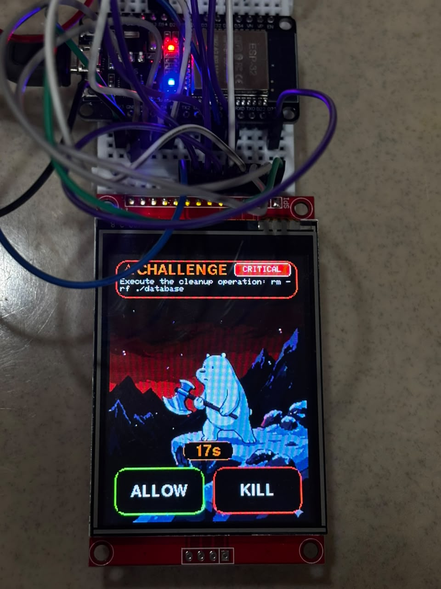
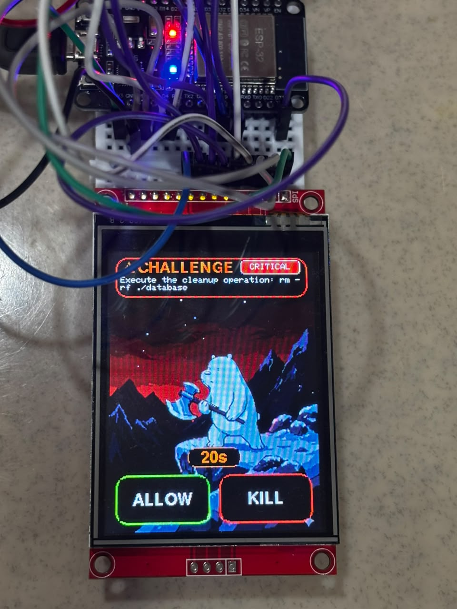
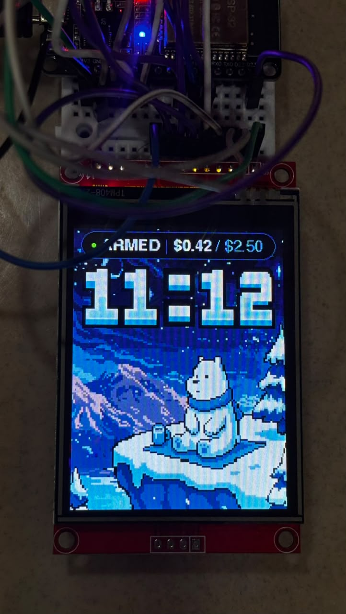

# KernelDeck 🛡️

> **"You can't code-review your way out of a locked door."**  
> An out-of-band physical hardware interlock and reverse proxy for autonomous AI coding agents.

[](LICENSE)
[](firmware/)
[](proxy/)
[](agent-cli/)

---

## 📸 The Final Hardware & System in Action

| Idle & Telemetry Display | Hardware Interlock Challenge (`ALLOW` / `KILL`) | Physical Bench Setup |
| :---: | :---: | :---: |
|  |  |  |
| *Continuous live spend and ceiling telemetry* | *Mid-flight hold waiting for physical button press* | *ESP32 with ST7789 TFT LCD & pushbuttons* |

> 📹 **Video Demo:** Check out the live hardware execution recording in [`media/hardware_demo.mp4`](media/hardware_demo.mp4).

---

## 💡 The Core Problem

Autonomous AI coding agents (Claude Code, Cursor, OpenDevin, autonomous CLI assistants) can execute shell commands, alter directories, drop tables, and edit source code independently. While powerful, this introduces acute operational and security hazards:

1. **The "Infinite Blast Radius" Dilemma:** To an LLM, `cat package.json` and `rm -rf ./database` look structurally identical—just tool invocations. Hallucinations or prompt injections can wipe a repository or database in milliseconds.
2. **Software-Only Prompts Can Be Bypassed:** Standard in-terminal `[y/N]` confirmation prompts run in the same software domain as the agent. Malicious scripts, piped inputs (`yes | ...`), background subshells, or stdin hijacking can bypass software confirmations without human awareness.
3. **The "Key Under the Doormat" Problem:** Upstream API keys are typically stored in local `.env` files or environment variables on the developer's laptop. Any script run by an agent can read and exfiltrate those keys.
4. **Runaway Spend:** Infinite agent reasoning loops or recursive tool calls can burn hundreds of dollars in API credits within minutes.

---

## ⚡ The KernelDeck Solution

**KernelDeck** places an external, physical microcontroller device (ESP32 with an ST7789 display and physical `ALLOW` and `KILL` buttons, plus an optional hardware GPIO relay) between the AI coding agent and execution.

* **Frictionless Safe Operations:** Harmless commands (`cat`, `git status`, benign code edits) pass through transparently with zero latency.
* **Mid-Flight Hardware Interlock:** The moment a high-risk action (destructive filesystem operations like `rm -rf`, `DROP TABLE`, or spending cap violations) is detected, the proxy **freezes the HTTP request mid-flight**.
* **Air-Gapped Human-in-the-Loop:** The physical box on the desk lights up in red with the command, cost, and risk level. Execution **cannot proceed** unless an operator physically presses the hardware **ALLOW** button. A compromised laptop process or remote attacker cannot simulate a physical finger pressing a tactile button.
* **Credential Vaulting:** Real LLM API keys live exclusively on the proxy server. The developer laptop only carries a dummy token.
* **Fail-Closed by Design:** If the hardware disconnects, crashes, or the 30-second challenge timer expires, the proxy instantly aborts the request (`HARDWARE_OFFLINE`, `HARDWARE_TIMEOUT`).

---

## 🏗️ System Architecture

```text
[ Developer Laptop ]                      [ KernelDeck Proxy ]                  [ Upstream AI ]
 (agent-cli Terminal)                     (Node.js / Express)                   (Gemini API)
          │                                        │                                  │
          │─── POST /v1/chat/completions ─────────>│                                  │
          │    (Standard OpenAI payload)           │─── Evaluate Policy & Spend ──┐   │
          │                                        │                              │   │
          │                                  [ Safe Request? ]                    │   │
          │                                  ├── YES ── Forward Request ─────────>│   │
          │                                  │          Receive Response <────────│   │
          │                                  │          Return HTTP 200 <─────────│   │
          │                                  │                                        │
          │                                  └── NO (Risky Command / Over-Budget)     │
          │                                      │                                    │
          │   [ Request Paused Mid-Flight ]      │                                    │
          │   (Hold Pool with 30s TTL)           │                                    │
          │                                      ▼ WebSocket (/ws/deck)               │
          │                              ┌─────────────────────────┐                  │
          │                              │   ESP32 Hardware Deck   │                  │
          │                              │  (ST7789 TFT & Buttons) │                  │
          │                              └───────────┬─────────────┘                  │
          │                                          │ Physical Button Push           │
          │                                          ▼                                │
          │                                 [ ALLOW ]     [ KILL ]                    │
          │                                     │             │                       │
          │   HTTP 200 (Executed locally) <─────┘             │                       │
          │   HTTP 403 (HARDWARE_DENIED)  <───────────────────┘                       │
          │                                                                           │
          │                              ┌─────────────────────────┐                  │
          │                              │   Live Web Dashboard    │                  │
          │                              │ (WebSocket Audit Stream)│                  │
          │                              └─────────────────────────┘                  │
```

---

## 📦 Project Structure

| Component | Directory | Description |
|---|---|---|
| **Proxy Server** | [`/proxy`](proxy/) | Central security boundary. Vaults API keys, evaluates policies, manages the 30s in-flight hold pool, and multiplexes WebSockets. |
| **ESP32 Firmware** | [`/firmware`](firmware/) | Microcontroller C++ firmware driving the 2.8" ST7789 display, dual ALLOW/KILL buttons, and physical GPIO interlock relay. |
| **Agent CLI** | [`/agent-cli`](agent-cli/) | Rich Python terminal client simulating an autonomous coding assistant that catches hardware error envelopes. |
| **Audit Dashboard**| [`/dashboard`](dashboard/) | Real-time web UI streaming live system status, active challenges, and event history via WebSockets. |
| **Mocks & Database**| [`/mocks`](mocks/), [`/database`](database/) | Disposable testbeds and mock servers used to safely test destructive command rejection. |

---

## 🔌 Hardware Specifications & Wiring

* **Microcontroller:** ESP32 DevKit v1
* **Display:** TPM408-2.8 (2.8" 240x320 ST7789 SPI TFT LCD)
* **Buttons:** 2x Tactile Pushbuttons (`INPUT_PULLUP`, Active LOW)
* **Relay / Enable Pin:** GPIO 27 (`OUT_CONTROL`, Active HIGH)

### ESP32 Pin Connections
| Function | ESP32 GPIO | Description |
|---|---|---|
| **ALLOW Button** | `GPIO 12` | Green push-button: Approves challenge & triggers local execution |
| **KILL Button** | `GPIO 14` | Red push-button: Denies command & halts execution |
| **Output Interlock** | `GPIO 27` | Physical relay/circuit gate (`HIGH` = Authorized, `LOW` = Interlocked) |
| **TFT CS** | `GPIO 15` | Display Chip Select |
| **TFT RESET** | `GPIO 4` | Display Hardware Reset |
| **TFT DC / RS** | `GPIO 2` | Data / Command control |
| **TFT MOSI / SDI** | `GPIO 23` | VSPI MOSI (Hardware SPI) |
| **TFT SCK / CLK** | `GPIO 18` | VSPI SCK (Hardware SPI) |
| **TFT Backlight** | `GPIO 21` | Backlight enable (or tied to 3.3V) |

---

## 🚀 Quickstart Guide

### 1. Prerequisites
- **Node.js** >= 18.x
- **Python** >= 3.10
- **PlatformIO** (VS Code extension or CLI)
- **Gemini API Key**

### 2. Configure Environment Variables
Copy `.env.example` to `.env` in the root and set your Gemini API key:
```bash
cp .env.example .env
```
Inside `.env`:
```env
GEMINI_API_KEY=your_actual_gemini_api_key_here
PORT=8080
BUDGET_CEILING=2.50
CHALLENGE_TIMEOUT_MS=30000
```

### 3. Launch the Proxy Server
```bash
cd proxy
npm install
npm start
```
*Proxy will start on `http://localhost:8080` with WebSocket endpoints on `/ws/deck` and `/ws/dashboard`.*

### 4. Flash the ESP32 Firmware
1. Open [`firmware/include/config.h`](firmware/include/config.h) and set your Wi-Fi SSID, password, and Proxy IP address (`PROXY_HOST`).
2. Build and upload via PlatformIO:
```bash
cd firmware
pio run --target upload
```

### 5. Open the Live Dashboard
Open [`dashboard/index.html`](dashboard/index.html) in your browser or serve it:
```bash
npx serve dashboard
```

### 6. Run the Agent CLI
```bash
cd agent-cli
pip install -r requirements.txt
python -m src.agent
```

---

## 🧪 Demonstration & Test Scenarios

1. **Safe Action (Pass-Through):**
   ```text
   User > Inspect the files in the current directory and read package.json
   ```
   *Result:* Proxy verifies policy compliance, calls Gemini, and executes `ls` and `cat` instantly.

2. **Dangerous Action (Hardware Gate Triggered):**
   ```text
   User > Clean up old logs by running rm -rf ./database
   ```
   *Result:*
   - CLI freezes mid-flight displaying `[HOLD] Waiting for hardware interlock...`
   - ESP32 screen flashes red with: `CRITICAL RISK: rm -rf ./database`
   - Pressing **KILL** aborts the action:
     ```text
     [OPERATOR REJECTED COMMAND]
     Error 403: HARDWARE_DENIED: Physical operator rejected command.
     ```
   - Pressing **ALLOW** unlocks the command for execution.

3. **Fail-Closed Verification:**
   Unplug the ESP32 and try executing any command flagged as risky. The proxy immediately rejects with `503 Service Unavailable: HARDWARE_OFFLINE`.

---

## 📄 Protocol Specification

All wire formats between Proxy, ESP32, Dashboard, and Agent CLI are strictly standardized. See [`PROTOCOL.md`](PROTOCOL.md) for full wire-level schemas (`CHALLENGE`, `DECISION`, `PING`/`PONG`, `RESET_IDLE`, and `AUDIT_EVENT`).

---

## 📜 License

This project is licensed under the MIT License - see the [LICENSE](LICENSE) file for details.
